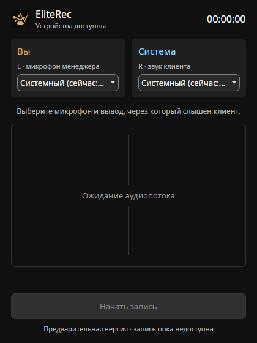

# R1 — каркас Linux-версии

27 октября 2026. R1 реализован; Release-сборка и локальные проверки проходят.
Workflow CI подготовлен, удалённый запуск GitHub Actions не выполнялся.

## Проекты

| Проект | Ответственность |
|---|---|
| `shared/src/EliteRec.Core` | Общие модели устройств, явный системный выбор, сравнение снимков, настройки по постоянным ID |
| `src/EliteRec.Audio.Pulse` | Каталог через libpulse, системные вход/выход, привязка вывода к его monitor-source, подписка на изменения |
| `src/EliteRec.App` | Запускаемое окно Avalonia 12.1.3, две колонки «Вы / Система», выбор и сохранение устройств |
| `tools/EliteRec.Probe` | Диагностический стенд R0; не является реализацией продуктового тракта |
| `tests/*` | Core, Pulse-правила, модель окна, headless-отрисовка и проверки R0 |

Проекты кодирования и обновляльщика добавляются, когда появится их реализация
(R3/R6). Общий код пока находится в обычном каталоге `shared/`, не в подмодуле.
Продукт не ссылается на исходники EliteSIP по внешнему пути.

## Перенос из EliteSIP

Перенесены и адаптированы схема `PulseConnection`, ABI `Native/LibPulse`,
сбор снимка `PulseIntrospection`, правила фильтрации/имён и сравнение снимков
из `PulseDeviceWatch`. Телефонные правила эхоподавления и автоматической
подмены гарнитуры рекордеру не нужны и не включены.

- Подписка на source/sink/server — только сигнал worker-потоку; запросы списка
  не выполняются внутри native callback.
- Пачка событий склеивается за 50 мс; сравнение выполняется по постоянному
  имени, а не номеру в списке. Громкость не входит в модель изменения маршрута.
- Подключение и каждая операция имеют таймаут 5 с и поддерживают отмену.
  Ошибка/неполный ответ сервера не превращаются в «успешный пустой список».
- При потере сервера наблюдение повторяет подключение. Остановка снимает
  callback под замком и удерживает GCHandle до завершения native-вызовов.
- Микрофонный список исключает monitor-sources. Для вывода берётся
  **реальное имя монитора из libpulse**, не предполагаемый суффикс `.monitor`.
- Нативные раскладки проверены на Linux x64. ARM64 и 32-bit не проверялись;
  32-bit отклоняется до чтения структур.

Это каркас для R4: переключение активной записи на запасное устройство,
обратный возврат и временные отметки пока не реализованы.

## Выбор и настройки

`null` в настройках означает явный выбор «Системный». Конкретный ID означает
конкретное устройство. Исчезнувший ID остаётся выбранным и показывается как
недоступный; появление системного устройства его не заменяет. После возврата
того же ID выбор снова разрешается в доступное устройство.

Файл: `${XDG_CONFIG_HOME}/EliteRec/devices.json`, а если XDG-путь не задан или
не абсолютный — `~/.config/EliteRec/devices.json`. Запись через временный файл,
flush и атомарное переименование. Обновление списков не перезаписывает выбор.
При повреждении настроек файл сохраняется для разбора и не затирается
значениями по умолчанию; интерфейс сообщает об ошибке.

## Что видно в окне

Окно 420×560, графит, выбранная золотая корона со звуковой волной. Слева —
«Вы» (L, золотой), справа — «Система» (R, голубой); оба списка содержат реальные
устройства и явный системный пункт. Длинные названия доступны в подсказке.
Строки находятся в `.resx` для дальнейшей локализации.

Центральная область пока пустая, без вымышленных уровней. «Начать запись»
отключена с пояснением, что запись недоступна в предварительной версии.
Живые уровни и тракт появятся в R2; полная «бабочка», трей без короны,
цвета статуса, горячие клавиши и остальные сценарии интерфейса — в R5.



## Проверки

- Release-сборка: 0 предупреждений, 0 ошибок.
- Тесты: 32 (13 R0, 8 Core, 6 Pulse, 5 App), все прошли.
- Окно действительно построено и отрисовано Avalonia/Skia без экрана;
  проверены два списка и недоступность кнопки записи.
- На живом PipeWire проверены системные устройства, появление и удаление
  временного null-sink, связь с монитором, исключение монитора из микрофонов
  и корректное завершение наблюдения по SIGINT.
- При заведомо недоступном сервере `--devices` вернул структурированную ошибку
  и код 2 без падения.
- Перезапуск реального аудиосервера и физический USB hotplug не выполнялись.

Результат живой проверки: [device-smoke.json](r1-results/device-smoke.json).
Она не захватывает микрофон, не меняет громкость реальных устройств и
удаляет только собственный временный вывод.

## Запуск

Из корня репозитория:

```bash
dotnet restore EliteRec.Linux.slnx
dotnet build EliteRec.Linux.slnx -c Release --no-restore
dotnet test EliteRec.Linux.slnx -c Release --no-build --no-restore
dotnet run --project src/EliteRec.App -c Release --no-build

# Каталог/наблюдение без графической сессии и без pactl:
dotnet src/EliteRec.App/bin/Release/net10.0/EliteRec.App.dll --devices
dotnet src/EliteRec.App/bin/Release/net10.0/EliteRec.App.dll --watch-devices

# Живой интеграционный тест (ему нужен pactl):
python3 scripts/r1-device-smoke.py
```

Для окна нужна графическая пользовательская сессия. Каталог/наблюдение используют
`libpulse0` напрямую. `pulseaudio-utils` нужен только R0 и smoke-скриптам,
не продуктовой части. Обычные тесты каталога и UI не требуют аудиосервера.
Настоящее X11-окно и целевая EliteLinux/Debian 13 пока не проверялись;
отрисовка проверена в headless-режиме.

Локальное восстановление выполнено из имеющегося кэша NuGet с отключённым
аудитом (`-p:NuGetAudit=false`). В CI используется обычный restore.
Из-за ограничений песочницы VSTest и живой аудиотест выполнялись вне неё;
сборка и отрисовка через тестовый host успешно прошли.

## Следующий этап

R2: два продуктовых record-stream, общий таймлайн, компенсация рассогласования,
моно-микс и разделённое стерео, WAV-выход. Не закрытые аппаратные проверки R0
остаются обязательными и не заменяются прохождением R1.
