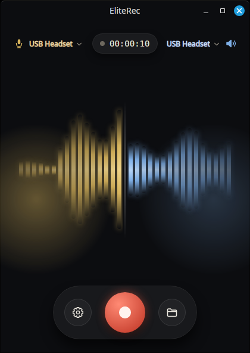
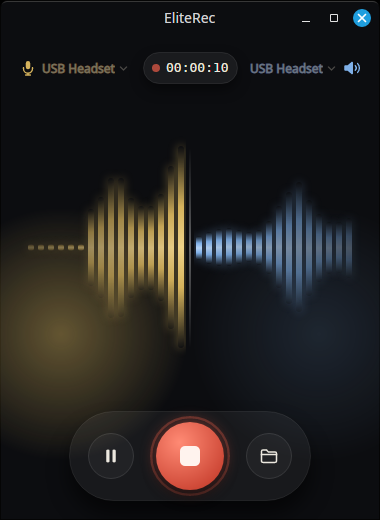
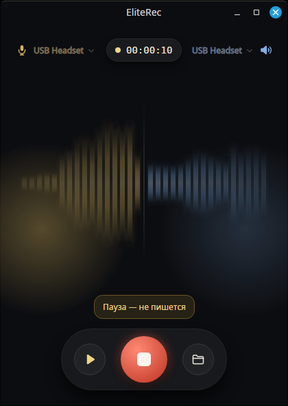
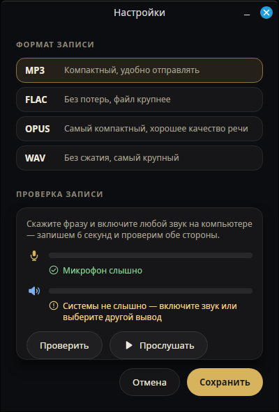
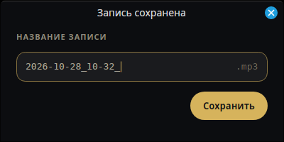

# R5 — интерфейс

28 октября 2026. **R5 сделан, кроме проверки с менеджером:** главное окно по
макету 6 «Стеклянная волна», трей, уведомление о старте, название записи после
«Стоп», окно настроек с самопроверкой. Горячей клавиши не будет (решение
28 октября 2026).

Макеты: https://claude.ai/artifact/GLQ6PSRoc5V1crQ5CWN3Ch (артборды 4, 4a, 4b;
выбран 6 — развитие 4).

## Окно

    

- **Верх:** микрофон (золотой значок, текст, шеврон), таймер, вывод (текст,
  шеврон, голубой значок динамика) — устройства просто текстом, без рамок. Это ComboBox без стрелки и
  фона: щелчок по имени открывает список. Показывается само устройство
  (для «Системного» — текущее умолчание), полное название — во всплывающей подсказке. Точка у
  таймера: серая до записи, красная мигает в записи (по таймеру окна, 0,8 с), жёлтая на паузе.
- **Волна** (`LevelWave`): 16 капсул на сторону от центральной оси. Уровень
  расходится от оси (капсула i повторяет уровень i тиков назад, тик 50 мс),
  поверх — бегущая синусоида, к краям спад высоты и прозрачности. Подъём
  быстрый, спад медленный; высоты сглажены переходом 90 мс. Шкала — от фона
  каждой стороны, а не абсолютная: фон — минимум сглаженного уровня (пик за
  200 мс) за 2 с, волна начинается на 10 дБ выше него и доходит до полной
  высоты к −3 дБ. На абсолютной шкале −66…0 у JBL Quantum 350 молчание (фон
  около −20…−30 дБ) рисовалось на 0,7 высоты, а речь — на 0,95; теперь
  молчание 0,1–0,25, речь 0,9–1 (проверено на записи 2026-10-28_10-31).
  Тишина — короткая капсула, а не пустота. Капсулы с градиентом,
  тающим к концам, и цветным свечением (`BoxShadow`).
- **Подсветка фона** за говорящей стороной — радиальный градиент, прозрачность
  следует за уровнем у оси.
- **Кнопка записи** до записи бледная и без свечения, в записи — яркая красная
  со свечением и кольцом: пишем или нет — видно издалека.
- **Стеклянная капсула кнопок:** до записи — «Настройки», красная «Запись»,
  «Папка»; в записи — «Пауза», «Стоп» с кольцом, «Папка»
  (`xdg-open`). На паузе волна гаснет до 35 %.
- **Текст — только по делу:** плашка появляется на паузе, при предупреждении
  об устройстве или ошибке (жёлтая), после записи («Сохранено …») и пока звука
  нет (подключение, устройства недоступны).
- **Настройки** (отдельное окно): формат записи (MP3/FLAC/OPUS/WAV с пояснениями)
  применяется только по «Сохранить» — переключатель на главном экране давал
  случайные щелчки. **Самопроверка:** 6 секунд настоящей записи в WAV во
  временную папку через ту же сессию, что и обычная запись; во время пробы —
  уровни обеих сторон, после — вердикт по каждой (слышно, если пик громче
  −46 дБ) и «Прослушать» стерео-файл (слева вы, справа система, `paplay`).
  Проба удаляется при закрытии окна; сессия предпрослушивания пересоздаётся,
  чтобы на главном экране не осталось «Сохранено …».
- **Заголовок окна** в цвет фона, как у EliteSIP: окна без системных рамок
  (`WindowDecorations="None"`), свой `TitleBar` повторяет системный заголовок
  xfwm (высота 32, название по центру, «свернуть», «развернуть», синий круг
  «закрыть», скругление верхних углов 7 — сняты со снимка экрана); отличается
  только фоном. Перетаскивание и двойной щелчок — как у системного. Размер меняется
  за края и углы (свои невидимые «ручки» по 6 px, `BeginResizeDrag`). Окно
  380×520, минимум 320×420; имена устройств обрезаются в своей колонке и не
  заходят под таймер.
- **Значки** — из набора EliteSIP (`Icons.axaml`, извлечён из
  `EliteSIP.App.Theme.Icons.xaml`): микрофон, динамик, шестерёнка, пауза,
  воспроизведение, шеврон, галочка, восклицательный знак; папка дорисована
  в той же манере. Элемент `app:Icon Kind="…"`.
- **Устройства** — текст со значком и шевроном ⌄: видно, что их можно сменить.
- **Иконка:** корона и волна на подложке как у EliteSIP (скруглённый квадрат,
  градиент #36363F → #16161E), знак занимает 74 % ширины; волна двухцветная — левая половина золотая,
  правая голубая, центральная капсула разделена по оси. Собирается
  `scripts/make-icon.py` из `docs/brand/eliterec-mark.png`, размеры 16–512
  в `docs/brand/`.

, во время записи строка скрыта.

## Проверки

| Проверка | Результат |
|---|---|
| Тесты | 83 прошли (смоук-проверки r2, r3, r4, r5-load — на PipeWire машины разработки); `ByDefaultOnlyStereoFileUnderPlainName`; `WaveIgnoresSteadyBackgroundAndShowsSpeechAboveIt`; `NameTests` (имена по минуте, занятые имена, чистка и дописывание названия), `MixLevelsScaleEachSideOnlyInMix`, `TrayIsGrayIdleRedWhileRecordingYellowOnPauseOrWarning`, `SettingsSaveFolderAndMixVolumesInOneWrite`, `SavedNoticeShowsRenamedFileUntilNextRecording`, `TitleDialogRenders`; `SelfTestJudgesEachSideAndOffersPlayback`, `SelfTestUnavailableWithoutAudioExplainsWhy`, `SettingsWindowRenders`, `LongDeviceNamesStayClearOfTimer`; `ChipShowsDeviceNotItsRole`; `WaveRisesAtAxisFirstAndSpreadsOutward` — волна от оси, медленный спад; `WaveUsesDbScaleStubAndGlowAndSettlesOnPause` — шкала дБ, подсветка, прозрачность к краям, на паузе оседает; `DeviceChoiceSurvivesNewDeviceList` — выбор устройства виден, когда список пришёл после показа окна |
| Снимки окна (headless Avalonia) | idle / recording / paused — в [r5-results](r5-results/) |

Найдено на снимках и исправлено: строка состояния наезжала на подписи каналов
(подписи сокращены до «L · микрофон» / «R · клиент»); символ «⚠» отсутствует
в моноширинном шрифте и не рисовался — заменён на «!».

Найдено в живом окне и исправлено: выпадающие списки устройств были пустыми —
список устройств приходит уже после показа окна, новый `ItemsSource` сбрасывает
выбор ComboBox, и привязка `SelectedItem` после этого не обновлялась (снимки этого
не ловили: там список задавался до показа). Выбор теперь синхронизирует
code-behind. «Бабочка» в тишине была пустой — добавлена полоса тишины.

Живое окно в виде макета 6 запускалось до записи; запись со звуком вживую
после этих изменений не проверялась. Чип показывает устройство без роли:
PipeWire называет источники «Микрофон (JBL …)», в чипе — «JBL …».

## Трей, уведомления, название, настройки

- **Трей** (`Tray`, Avalonia `TrayIcon`, как в EliteSIP): значок — только волна
  из-под короны: двухцветная вне записи, красная в записи, жёлтая на паузе или
  при предупреждении об устройстве. Подсказка — состояние и таймер. Меню: «Начать
  запись» или «Пауза/Продолжить» и «Остановить и сохранить», «Открыть окно»,
  «Открыть папку записей», «Выход»; щелчок по значку — окно.
- **Крестик прячет окно в трей**, запись продолжается; первый раз приходит
  уведомление «EliteRec работает в трее». Выход — из меню значка; идущая запись
  при выходе сохраняется (без названия). Трей включается, только если панель
  его показывает (`IsStatusNotifierHostRegistered` у StatusNotifierWatcher, как
  в EliteSIP); иначе крестик закрывает программу, как раньше.
- **Уведомление при старте** — «Идёт запись. Предупредите клиента, что разговор
  записывается.» через `org.freedesktop.Notifications`.
- **Один файл** по умолчанию (решение 28 октября): стерео `2026-10-26_14-30.mp3`,
  слева микрофон, справа система — его отправляют на расшифровку. Галочкой в
  настройках — ещё общий моно-микс `…_mono.mp3`. Занятое
  имя — `-2`, `-3` (`RecordingNames`). После «Стоп» — диалог «Название записи»:
  видно имя файла (`2026-10-28_10-32_`), за ним поле, куда дописать название, и
  одна кнопка «Сохранить» (пустое поле или закрытие — имя как есть). Название
  дописывается к обоим файлам и файлу событий (`2026-10-28_10-32_Иванов, КП.mp3`), символы,
  недопустимые в Linux и Windows, вычищаются. Затем открывается папка с
  выделенными файлами (`org.freedesktop.FileManager1.ShowItems` — Thunar;
  иначе просто папка).
- **Каналы проверены по файлу** (28 октября, JBL Quantum 350): в
  стерео-файле корреляция левого и правого ≈ 0,00 — разные сигналы; слева
  растёт громкость, когда говорит менеджер, справа — звук системы. Общий
  моно-файл в обоих ушах звучит одинаково: так и задумано.
- **Настройки:** формат; папка записей (по умолчанию «Записи EliteRec» на рабочем
  столе); «Также сохранять общий файл (моно)» и, только для него, громкость
  микрофона и системы (25–200 %, по умолчанию 1:1; стерео-файл не меняется —
  он для расшифровки); самопроверка. Всё
  сохраняется одной записью по «Сохранить».
- D-Bus — через Tmds.DBus.Protocol (уже приходит с Avalonia), без `notify-send`
  и `gdbus`.

## Нагрузка и подвисания (слабые ПК)

Цель: ноутбук A6 / 4 ГБ DDR3 / HDD, где параллельно Телемост с камерой,
мессенджер и браузер. Замеры — на i7-10750H (одно ядро примерно в 2,5 раза
быстрее A6), % — одного ядра; до → после правок 28 октября:

| Состояние | CPU | Память |
|---|---|---|
| Окно открыто, до записи | 16,3 % → 2,8 % | ≈190 МБ (EliteSIP — 181 МБ) |
| Окно свёрнуто или в трее, до записи | 5,5 % → 0,4 % | — |
| Запись MP3, стерео + моно, без окна (Recorder) | 8,3 % → 4,3 % | 51 МБ |
| Захват без кодирования (WAV) | 4,1 % → 3,3 % | 50 МБ |

Что сделано:
- **Окно:** убраны 32 размытые тени капсул, переходы высоты и анимации кольца
  и точки — они перерисовывали окно с частотой экрана без перерыва; точка
  мигает по таймеру. Таймер окна: 50 мс, пока окно видно; 0,5 с, если окно
  спрятано и идёт запись; стоит, если спрятано и записи нет (20 пробуждений
  в секунду стоили около 4 % ядра впустую).
- **В трее до записи захват закрыт** — откроется, когда окно покажут или
  запись начнут из меню значка.
- **Захват:** блоки от сервера по 100 мс вместо 20, цикл сведения раз в 30 мс
  вместо 10 (сводим с запасом 250 мс — чаще не нужно).
- **MP3:** LAME `quality 7` вместо 2 — на 192 кбит/с речь не отличить, CPU
  кодера вдвое меньше.
- Память — нижняя граница Avalonia с GPU-отрисовкой (драйвер Mesa ≈50 МБ);
  настройки сборщика мусора её не меняют (проверено).

Подвисания (система не даёт процессу времени: своп на HDD) — раньше обрывали
запись четырьмя путями; исправлено:
1. буфер на сервере — 10 с вместо 1 с;
2. устаревшая после подвисания метка времени — время блока продолжается от
   предыдущего, а не «Потеряны метки времени» (после переполнения — блок
   пропускается, а не ошибка);
3. «нет данных 2 с — источник пропал» не срабатывает 3 с после того, как цикл
   сам не просыпался дольше 0,5 с;
4. потеря данных больше 100 мс больше не завершает запись: тишина на этом
   месте и строка «Пропуск звука N мс — компьютер не успевал» в файле событий;
   буфер сведения — 10 с вместо 2 с.

Проверено `scripts/r5-load-smoke.py` (SIGSTOP процесса записи на 1, 3, 6 и
12 с): запись не обрывается, длина точная, потерь 0, переполнений 0;
`r2-audio-smoke.py --stall-ms 4000`: расхождение каналов 17,4 мс при допуске 50.

## Один экземпляр и выход из сеанса

- Второй запуск (ярлык при работающем автозапуске) не открывает второе окно и
  вторую запись: имя `vip.elitesip.EliteRec` на шине D-Bus сессии занято —
  второй просит первый показать окно и выходит (проверено: код 0, окно одно).
- SIGTERM/SIGHUP (выход из сеанса, выключение): идущая запись дописывается
  штатно, как «Стоп» (без названия), без участия окна — X-сервер к этому
  моменту может уже уйти; затем выход. Дописывание при закрытии сессии
  проверено `r2-audio-smoke.py --close-active`.

## Что не проверено

- Сценарий целиком с менеджером («проходит запись без подсказок») — критерий R5.
- Вживую: уведомление о старте, диалог названия и выделение файлов в Thunar,
  выход из трея во время записи, самопроверка. Значок трея на панели EliteLinux
  (Xfce) появился.
